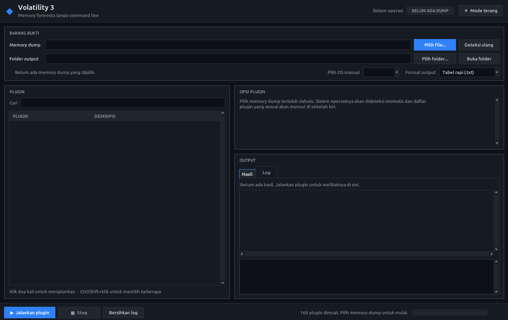

<div align="center">

# ◆ Volatility 3 GUI

### Memory forensics without the command line, powered by a 🦀 Rust engine.

**Pick a memory dump → the OS is detected automatically → click a plugin → results show up as an interactive table.**

-CE422B?logo=rust&logoColor=white)




</div>

---

## 🤔 Why this GUI?

[Volatility 3](https://github.com/volatilityfoundation/volatility3) is the world's most widely used memory forensics framework. But to use it you have to memorise plugin names, remember their options, guess which OS a dump came from, and then read text tables hundreds of characters wide in a terminal.

```text
$ vol -f dist.dmp windows.pslist.PsList --pid 4 --dump
$ vol -f dist.dmp windows.malware.malfind.Malfind ...
$ vol -f memory.lime --remote-isf-url '...' linux.pslist   # wait, which plugin was it again?
```

**Volatility 3 GUI** removes all of that friction. One window and a few clicks, and you can focus on what actually matters: **analysing the evidence**, not typing commands.

> Built for students learning digital forensics, CTF players racing the clock, and DFIR analysts who want fast triage.

---

## 🦀 Rust Engine: vol-rs

The analysis is done by **[vol-rs](https://github.com/daffainfo/vol-rs)**, a port of Volatility 3 to **Rust**. It is a single native binary that keeps the plugin names and options of `vol.py`, so nothing new has to be learned.

| | vol-rs (default) | vol.py (fallback) |
|---|---|---|
| Language | 🦀 Rust, native binary | 🐍 Python |
| Installation | Downloaded automatically into `bin/`, checksum verified | Needs Python packages (`pefile`, `capstone`, ...) |
| Plugins | Same names and options as Volatility 3 | The original Volatility 3 framework |
| Progress bar | Shows that a run is active (vol-rs reports no percentage) | Shows the percentage |

- `run_gui.sh` and `run_gui.bat` install vol-rs on first start with [`install_vol_rs.py`](install_vol_rs.py). It downloads a pinned release (v1.0.2) for your OS and checks its SHA-256 before using it.
- The log shows which engine is active each time the GUI starts.
- vol-rs uses the same symbol folder as `vol.py` (`volatility3/symbols`), so ISF files you have collected work with both.
- To use `vol.py` instead, set `VOL_GUI_ENGINE=python` before starting the GUI.

---

## ✨ Features

| | Feature | Description |
|---|---|---|
| 🦀 | **Rust analysis engine** | Plugins run on vol-rs, a native Rust build of Volatility 3. `vol.py` takes over automatically if the binary is missing. |
| 🔍 | **Automatic OS detection** | Just pick a file. The GUI recognises Windows crash dumps from their header, tries `windows.info`, then searches for Linux/Mac kernel banners. The plugin list is filtered to match the OS. |
| 🧩 | **190+ plugins, nothing to memorise** | Every plugin is listed with its description, grouped by OS, and searchable. |
| ⚙️ | **Plugin options become a form** | `--pid`, `--dump`, `--physical` and friends turn into checkboxes, text fields or dropdowns. An *extra arguments* field takes anything else. |
| 📊 | **Interactive result table** | Sort by any column (click its header), select a row to see its full content, and press `Ctrl+C` to copy rows to the clipboard (ready to paste into Excel). |
| 🚀 | **Run many plugins at once** | `Ctrl/Shift+click` several plugins and they are queued and run one after another. |
| 💾 | **Output saved automatically** | Every run is saved to its own timestamped file as a clean `.txt` table, `.csv`, `.json` or `.jsonl`. Files extracted with `--dump` go into their own folder. |
| 📈 | **Live results and progress** | Rows appear in the table as they stream in, and the progress bar shows a run is still going instead of a silent terminal. |
| 🛑 | **A Stop button that really stops** | Each plugin runs in a separate process, so a plugin that hangs or crashes can never freeze the GUI. |
| 🩺 | **Human-readable errors** | Common failures (missing symbol table/ISF, corrupt dump, PDB download failed) are explained in plain language with a suggested fix. The full log is kept as an `.error.log` file. |
| 🌗 | **Dark & light mode** | Switch themes with one click; your choice is remembered. |
| 🪟 | **WSL friendly** | Paste a Windows path like `C:\dumps\mem.raw` and it becomes `/mnt/c/dumps/mem.raw`. The *open folder* button opens Windows Explorer. |

> ℹ️ The interface text is currently in **Indonesian**. The usage guide below gives the English meaning of every button you need.

---

## 📦 Installation

### Requirements

- **Python 3.8+** (for the GUI itself)
- **Tkinter**
  - Windows & macOS: included with the Python installer from [python.org](https://www.python.org/downloads/).
  - Debian/Ubuntu/WSL: `sudo apt install python3-tk python3-venv`
- An internet connection, to download vol-rs on first start and Windows PDB symbols the first time a dump is analysed.

### Clone the repository

```bash
git clone https://github.com/soulahuden/volatility3-gui.git
cd volatility3-gui
```

### Install the Rust engine

The GUI itself **uses only the Python standard library**. The launchers (`run_gui.sh`, `run_gui.bat`) install vol-rs into `bin/` for you. To install it by hand:

```bash
python install_vol_rs.py           # add --force to replace an installed binary
```

Prebuilt binaries are available for Linux (x86_64, arm64), macOS (x86_64, arm64) and Windows (x86_64).

> ⚠️ **Known issue in vol-rs 1.0.2:** it can silently miss processes when the process list in a memory image is damaged, which `vol.py` still finds. [`patches/vol-rs-1.0.2-list-walk.patch`](patches/vol-rs-1.0.2-list-walk.patch) fixes this. `install_vol_rs.py` installs the official release, so to get the fix, build it with Rust 1.85+ and replace the binary:
>
> ```bash
> git clone --depth 1 --branch v1.0.2 https://github.com/daffainfo/vol-rs
> git -C vol-rs apply "$PWD/patches/vol-rs-1.0.2-list-walk.patch"
> (cd vol-rs && cargo build --release)
> cp vol-rs/target/release/vol-rs bin/vol-rs
> ```

### Python fallback (optional)

These packages are only needed if you run on `vol.py` instead of vol-rs:

```bash
pip install pefile pycryptodome capstone yara-python
```

Or install all of Volatility 3's optional dependencies at once:

```bash
pip install -e ".[full]"
```

---

## 🚀 Running

### Windows

Double-click **`run_gui.bat`**. It installs vol-rs if needed, then opens the GUI. From Command Prompt/PowerShell:

```bat
python install_vol_rs.py
python vol_gui.py
```

### Linux / WSL / macOS

```bash
chmod +x run_gui.sh
./run_gui.sh
```

On first run, `run_gui.sh` creates a `.venv` virtualenv, installs the Python fallback dependencies and downloads vol-rs. After that it opens the GUI straight away.

Or run it manually:

```bash
python3 install_vol_rs.py
python3 vol_gui.py
```

> 💡 On WSL2 (Windows 11) the GUI opens as a normal window thanks to WSLg. No extra X server needed.

---

## 🧭 Usage

### 1. Choose a memory dump

Click **Pilih file...** (*Choose file*), or paste a path into the *Memory dump* field and press `Enter`. Supported formats include `.raw`, `.mem`, `.dmp`, `.vmem`, `.lime`, `.img`, `.bin`, `.dd`, `.elf`, `.core`, `.vmss`, `.vmsn` and `.sav`.

### 2. Let it detect the OS

The GUI detects the operating system and shows a **WINDOWS**, **LINUX** or **MAC** badge in the top-right corner. The plugin list on the left is filtered to that OS, plus the generic plugins that work on any OS.

If detection fails but you know the dump is valid, pick the OS from the **Pilih OS manual** (*Choose OS manually*) dropdown.

### 3. Select and configure a plugin

- Click a plugin to see its description and options in the **OPSI PLUGIN** (*Plugin options*) panel.
- Fill in what you need, e.g. `--pid 1234`, or tick `--dump`. Options marked **(wajib)** are *required*.
- Use the **Cari** (*Search*) field to find plugins quickly (try `malfind`, `cmdline`, `netscan`).

### 4. Run

- **Double-click** a plugin, press `Enter`, or click **▶ Jalankan plugin** (*Run plugin*).
- To run several plugins, select them with `Ctrl/Shift+click` and run. They are all queued.
- Click **■ Stop** to stop the running process and clear the queue.

### 5. Read the results

- **Hasil** (*Results*) tab: the interactive table. Click a header to sort, click a row to see its full content in the bottom panel, `Ctrl+C` to copy.
- **Log** tab: the active engine, the exact `vol-rs` (or `vol.py`) command that was run, warnings and error explanations.
- Click **Buka folder** (*Open folder*) to open the output folder.

### Output layout

By default, results are saved under `output/<dump-name>/`:

```text
output/
└── dist/
    ├── windows.pslist.PsList_20260930-160802.txt           # plugin result
    ├── windows.malware.malfind.Malfind_20261002-141525.txt
    ├── windows.dumpfiles.DumpFiles_20261002-150000_files/  # files extracted with --dump
    └── windows.netscan.NetScan_20261002-151000.error.log   # log when a plugin fails
```

> The `output/` folder is listed in `.gitignore`, so analysis results (which may contain sensitive data) are never pushed to GitHub.

### Output formats

| Option | File content |
|---|---|
| **Tabel rapi (.txt)** (*clean table*) | A readable text table with a header showing the plugin, file, time and row count. Long columns wrap; multi-line results (hexdumps, disassembly) are written as vertical records. |
| **CSV (.csv)** | For Excel, LibreOffice or pandas. |
| **JSON (.json)** | For automation or other tools. |
| **JSON Lines (.jsonl)** | One object per line; great for Splunk, ELK or `jq`. |

---

## 🐧 Tip: Linux Memory Dumps

For Linux, Volatility needs a **symbol table (ISF)** that exactly matches the kernel in the dump. If you see *"symbol table requirement was not fulfilled"*, there are two fixes.

> 📘 Step-by-step guide (in Indonesian): **[tutorial-install-symbol.md](tutorial-install-symbol.md)**. It covers reading the kernel banner, finding the matching ISF, and building one with dwarf2json.

**A. Use a remote ISF** (easiest). `--remote-isf-url` is a global option (it goes before the plugin name), so it can't be set through the *extra arguments* field. Run it from a terminal:

```bash
./bin/vol-rs -f memory.lime \
  --remote-isf-url 'https://github.com/Abyss-W4tcher/volatility3-symbols/raw/master/banners/banners.json' \
  linux.pslist
```

On Windows use `bin\vol-rs.exe`, or `python3 vol.py` with the same options for the Python engine.

**B. Download or build the ISF yourself.** Get a ready-made one from [Abyss-W4tcher/volatility3-symbols](https://github.com/Abyss-W4tcher/volatility3-symbols), or build it with [dwarf2json](https://github.com/volatilityfoundation/dwarf2json) for the kernel banner (see the output of the `banners.Banners` plugin). Then place the `.json.xz` file in:

```text
volatility3/symbols/linux/
```

Then run the plugin again from the GUI. ISF files are in `.gitignore` because they are tens of MB each.

---

## 🛠️ Troubleshooting

| Problem | Fix |
|---|---|
| Log says *Engine: vol.py (Python)* | vol-rs is not installed. Run `python install_vol_rs.py`, and check that `VOL_GUI_ENGINE` is not set to `python`. |
| `install_vol_rs.py` fails | Check your internet connection. If there is no prebuilt binary for your OS/CPU, build vol-rs from source with `cargo build --release` and copy it into `bin/`. |
| A process you expected is missing | vol-rs 1.0.2 can miss processes on a damaged process list. Apply the patch (see [Installation](#-installation)) or compare with `VOL_GUI_ENGINE=python`. |
| `ModuleNotFoundError: No module named 'tkinter'` | Install Tkinter: `sudo apt install python3-tk` |
| GUI doesn't appear on WSL | Make sure you're on WSL2 with WSLg (Windows 11), or run `run_gui.bat` directly on Windows. |
| *Windows symbol table not found* | Volatility needs to download PDBs from Microsoft's symbol server. Check your internet connection and try again. |
| *Memory dump cannot be read* | The file is corrupt/truncated, not a memory image, or the wrong OS is selected. |
| The first plugin is slow | That's normal. On the first run against a dump, Volatility has to prepare symbols. Later runs are much faster. |
| The table only shows 20,000 rows | This keeps the GUI responsive. The **complete** result is always in the output file. |

---

## 🧱 How It Works

```text
┌──────────────┐  subprocess   ┌──────────────────┐
│  vol_gui.py  │ ────────────▶ │  bin/vol-rs  🦀  │  (one process per plugin)
│  (Tkinter)   │ ◀──────────── │  Rust engine     │  fallback: vol.py
└──────────────┘  stdout: CSV  └──────────────────┘
       │           stderr: errors
       ▼
 interactive table + output file (.txt/.csv/.json/.jsonl)
```

The GUI reads the plugin list and each plugin's options from `vol-rs --list-plugins` and `vol-rs <plugin> --help`, then runs every analysis as a separate `vol-rs` process, using the symbols in `volatility3/symbols`. CSV output is parsed as it streams in, so the first rows appear before the plugin has finished.

| File | Purpose |
|---|---|
| `vol_gui.py` | The GUI application |
| `install_vol_rs.py` | Downloads the pinned vol-rs release into `bin/` and verifies its checksum |
| `patches/vol-rs-1.0.2-list-walk.patch` | Fix for vol-rs 1.0.2 missing processes on a damaged process list |
| `run_gui.bat` | Windows launcher (installs vol-rs, then opens the GUI) |
| `run_gui.sh` | Linux/WSL/macOS launcher (creates `.venv`, installs vol-rs) |
| `tutorial-install-symbol.md` | Guide to installing Linux symbol tables (ISF), in Indonesian |
| `README-VOLATILITY3.md` | The original Volatility 3 README |

---

## 🙏 Credits & Original Source

This GUI is **only a front-end**. All of the memory forensics capability comes from **Volatility 3**, developed and maintained by **[The Volatility Foundation](https://volatilityfoundation.org/)**, and from its Rust port **vol-rs**.

- 🦀 Rust engine: **[daffainfo/vol-rs](https://github.com/daffainfo/vol-rs)**
- 🔗 Volatility 3 repository: **[github.com/volatilityfoundation/volatility3](https://github.com/volatilityfoundation/volatility3)**
- 📖 Documentation: **[volatility3.readthedocs.io](https://volatility3.readthedocs.io/)**
- 🌐 Website: **[volatilityfoundation.org](https://volatilityfoundation.org/)**
- 🧬 Symbol tooling: **[dwarf2json](https://github.com/volatilityfoundation/dwarf2json)**
- 🐧 Ready-made Linux ISFs: **[Abyss-W4tcher/volatility3-symbols](https://github.com/Abyss-W4tcher/volatility3-symbols)**

Huge thanks to the Volatility and vol-rs developers and contributors for this outstanding open-source work. The original Volatility 3 README is available in [`README-VOLATILITY3.md`](README-VOLATILITY3.md).

---

## 📜 License

Volatility 3 is released under the **[Volatility Software License (VSL) v1.0](https://www.volatilityfoundation.org/license/vsl-v1.0)**. See [`LICENSE.txt`](LICENSE.txt). This GUI is distributed under the same license. vol-rs is distributed under its own license; see its [repository](https://github.com/daffainfo/vol-rs).

---

<div align="center">

**If this tool helps your investigation or CTF, please give the repository a ⭐!**

Made with ☕ by [@soulahuden](https://github.com/soulahuden) for the digital forensics community

</div>
